# CRACKUP production delivery plan

Version: 1.1 · November 13, 2026 · Scope: [complete-game requirements v3.1](PRODUCT_REQUIREMENTS_V3.md)

This plan starts after the existing engineering/Section 6 roadmap. **P0–P8 are new product milestones**, unrelated to the old gameplay Phases 1–6 or art Stages 1–6. No new product gate is already complete. Existing working mechanics and evidence are reusable inputs.

The goal is a complete premium PC game, fully playable offline solo with optional 1–8 co-op. Work begins with a measurable quality target and production pipeline, proves them in one opening operation, and expands only after that sample is accepted. It is designed for a solo owner using AI. The owner confirmed the working scope and **no additional spending**; see [baseline decisions](PRODUCT_BASELINE_DECISIONS.md). There is no fixed release date or assumed studio headcount. The [opening-operation specification](OPENING_OPERATION_SPEC.md) supplies the route, checkpoints, content gaps, acceptance scenarios and bounded P1 packages.

## 1. Order, dependencies, and working rules

```mermaid
flowchart LR
  P0["P0 Scope and audit"] --> P1["P1 Pipeline and feasibility"]
  P1 --> P2["P2 Player, combat and AI quality"]
  P2 --> P3["P3 Finished opening operation"]
  P3 --> P4["P4 Complete world"]
  P4 --> P5["P5 Campaign and co-op"]
  P5 --> P6["P6 Content-complete alpha"]
  P6 --> P7["P7 Qualified beta / candidate"]
  P7 --> P8["P8 Launch and support"]
```

Complete and verify the current gate before moving production to the next. Work inside a milestone can iterate across disciplines; planning and low-cost risk discovery can look ahead, but cannot be reported as completion of a dependent gate. Necessary co-op, save, accessibility, profiling and asset work starts in the early sample rather than being deferred to the end.

For each work session: select one acceptance-sized work package; identify requirement IDs; inspect the existing implementation before replacing it; implement content and behavior together; exercise a normal player route; attach evidence; record failures/remaining work. End with an updated ledger and a concrete next action. Do not commit, push, buy or deploy solely because a milestone description mentions those future actions.

## 2. Phase contracts

### P0 — Product baseline and honest inventory

**Entry:** this planning package and the current working tree. **Outcome:** an agreed launch contract, identified gaps and an executable first production package.

Work packages:

- **P0.1** Capture the actual build/working-tree identity, run the current game normally, and inventory missions, maps/interiors, assets/materials, animations by state, AI behaviors, sound/voice, UI, save state and tests. Mark each item reusable, requires rework, missing or needs evidence. Preserve existing behavior and local edits.
- **P0.2** Review v3's content envelope and functional/NFR targets. Confirm product pillars, solo/optional co-op, audience, launch languages, campaign progression and initial commercial assumptions. Record explicit changes rather than silently shrinking the game.
- **P0.3** Record the reference PC's exact CPU, desktop 4070/driver, 16 GB RAM, SSD, OS and display. Measure a baseline on the current build, including cold load and a crowded fight. Treat the hardware as a reference, not a utilization quota.
- **P0.4** Set art/experience reference boards and a state/actor animation coverage inventory. Write the opening operation's intended player experience and acceptance tasks.
- **P0.5** Record the confirmed zero-additional-spending and offline-solo decisions, owner hours, external dependencies and risks. Owner hours remain unknown; collect actual constraints before proposing migration.

**Exit gate:** owner baseline review is recorded; every requirement has accountable role, gate and initial status; inventory and measured baseline exist; P1 packages are sized to finish in a few focused sessions each. None of the game requirements is accepted merely by approving the plan.

**Evidence:** reviewed baseline/version, gap inventory, PC/profile report, initial captures, decision log and initial budget/capacity worksheet.

### P1 — Production pipeline and runtime feasibility

**Depends on:** P0. **Outcome:** a reproducible process capable of delivering and running the intended quality.

Work packages:

- **P1.1** Build the three reference scenes (street, rooftop, interior). Establish final material/light/outline treatment, scale, legibility and a representative accepted agent/faction design. Establish imports, UVs, sockets, collision, LOD, material/texture and audio rules.
- **P1.2** Build an asset/content intake and validation path: genuine sources, rights, hashes, naming/stable IDs, editable sources, export settings, rig/clip mapping, material channels, compression, dependency checks and target runtime previews. Reuse the existing asset manifest/intake workflow where it fits.
- **P1.3** Profile reference scenes plus representative eight-player load. Prototype bounded streaming/LOD, occlusion, physics/AI scheduling, realistic memory/cold-load costs and diagnostic capture. Choose budgets from frame-time evidence.
- **P1.4** Prove installed offline solo launch, durable campaign schema/checkpoints, co-op ownership policy, controller path and pause/focus behavior in a small test level. Offline support is required by the owner. Design migrations before content depends on the schema; use the measured P0 restart gap and proposed ownership contract in the decision record.
- **P1.5** Record the runtime/distribution decision. First optimize a measured bottleneck in the current Three.js/Rapier stack. If product requirements remain infeasible, timebox one representative alternative-engine comparison using equivalent art, gameplay and networking demands. Compare measured quality/performance and migration labor, not marketing claims.

**Exit gate:** the reference scenes pass owner art review; pipeline can re-export/rebuild them; reference-PC profiling and save/session feasibility support the planned experience; runtime/distribution and budgets are documented. If infeasible, revise architecture or scope openly and rerun P1 before mass content production.

**Requirement focus:** FR-ART-01, early samples of art/animation/saves/co-op and every high-risk NFR. **Evidence:** target scene captures, cook/import report, profiler traces, license records and architecture decision record.

### P2 — Player, combat, animation, and AI quality

**Depends on:** P1. **Outcome:** a repeatably enjoyable play loop in a small production-quality arena and traversal route.

Work packages:

- **P2.1** Finish player movement/camera and an explicit animation state/transition matrix. Integrate real or accepted authored/procedural locomotion, landing, aiming, melee, reactions, death and recovery. Fix contacts and blends before adding many motion variants.
- **P2.2** Finish two weapon roles, melee/counter timing, limb consequences, hit reactions, physical props, audio/visual feedback and difficulty assistance. Preserve authority and collision during animation/motion warping.
- **P2.3** Implement reliable navigation/perception, route recovery and three complementary AI roles with mixed encounters. Verify reachable/blocked destinations, lost-target search and counterable behavior, including vertical routes/interiors.
- **P2.4** Validate keyboard/mouse, controller, captions, motion settings, profile saving and latency under real client load. Include death/retry/disconnect so polished combat does not depend on an ideal path.

**Exit gate:** FR-PLAY-01/02/04, FR-AI-01/02 and FR-ANIM-02/04/05 pass their acceptance scenarios; the FR-ANIM-01 coverage matrix exists, with the core-loop states accepted and remaining actor/state gaps explicit for P5/P6. No broken core state/contact remains. At least five external players can use the loop and identify meaningful combat choices; feedback has a recorded disposition. P3 provides the larger ten-player experience gate.

**Evidence:** movement/camera route suite, animation coverage matrix and gameplay reel, AI scenario replays, 0/80/150 ms RTT comparisons, input tests and player observations. An animation viewer by itself is insufficient.

### P3 — Finished opening operation / vertical slice

**Depends on:** P2. **Outcome:** a representative 30–45 minutes of the final game, made with the actual production process.

Work packages:

- **P3.1** Author the contiguous Docks neighborhood, safehouse, furnished mission interior, street/roof/waterfront routes, landmarks, collectibles, civilian/traffic sample and environmental story.
- **P3.2** Build a complete mission from launch/briefing through movement, dialogue, multiple encounters, discovery, boss, reward and checkpoint/resume. Add one side mission, two challenges, an event and companion practice sample.
- **P3.3** Deliver final sample art, materials, animation, foley/weapon/vehicle sounds, performed dialogue, adaptive music and a staged skippable sequence. Build a final opening experience, not a cinematic around unfinished gameplay.
- **P3.4** Finish sample menus/map/journal, bindings, accessibility, solo pause policy and co-op session/reward/skip behavior. Validate solo, two/four-player play and eight-client peak load.
- **P3.5** Run ten unfamiliar-player sessions, physical reference-PC profiling and interrupted-save/reconnect scenarios. Record accepted work hours and revisions for every discipline; this is the production throughput sample.

**Exit gate:** every requirement applicable to the sample passes its scaled scenario; all sampled quality disciplines score ≥4/5; at least 8 of 10 unfamiliar players complete the opening uncoached and rate traversal, combat readability and world coherence ≥4/5. Performance demonstrates the reference target with representative content. No known sample campaign/data/accessibility blocker. Publish actual test results, scope and remaining limitations.

**Requirement focus:** FR-CORE-03, FR-UX-01–04/06, NFR-PERF-05, NFR-MAINT-02 plus representative coverage of every product pillar. **Evidence:** a playable candidate, full normal-input video, raw playtests, art/audio reviews, frame/memory/network traces, save/co-op tests and measured production worksheet.

**Scale decision:** if the sample is not fun, polished or sustainable, iterate here. Do not multiply unfinished districts. Reforecast full-game scope from actual accepted throughput; owner explicitly chooses more development time, targeted help or a scope revision where needed.

### P4 — Complete authored world and production tools

**Depends on:** P3. **Outcome:** all four districts exist as usable, differentiated places with validated navigation and production content.

Work packages:

- **P4.1** Plan all district neighborhoods, campaign/interior allocations, progression-tier routes, hubs, roads, sightlines and encounters. Preserve stable gameplay/collectible IDs; make a migration plan for moved persistent items.
- **P4.2** Produce reusable architecture/prop/material/lighting kits and district-specific landmarks. Build streets, roofs, shoreline/bounds, at least 12 meaningful interiors, dressing and environmental stories.
- **P4.3** Expand navigation, civilian/traffic behavior, map discovery and vertical route guidance. Apply LOD/streaming and physical boundaries to playable areas; clearly distinguish inaccessible scenery.
- **P4.4** Validate route density, collisions, accessibility, material coverage, lighting states and scene budgets in every neighborhood. Extend content validators to reject broken references and unreachable objectives.

**Exit gate:** all FR-WORLD-01–05/07 and FR-ART-03–05, NFR-PERF-08 and NFR-MAINT-01 pass. Every required critical-path space is traversable normally; no district is just a sparse placeholder behind an accepted opening. Missing mission scripts are explicitly tracked for P5/P6.

**Evidence:** world/interior inventory, editable maps, route/timing matrix, district capture set, population/navigation runs, material/streaming budgets and CI content validation.

### P5 — Full campaign, systems depth, and optional co-op

**Depends on:** P4. **Outcome:** the complete campaign is functionally playable end to end, with differentiated encounters and durable progress.

Work packages:

- **P5.1** Implement all 24 proposed campaign missions, side arcs, district changes, progression gates and essential narrative triggers. Resolve all act transitions and the ending/postgame state without QA shortcuts. Full final-content acceptance follows at P6.
- **P5.2** Expand the complete AI role set, district bosses, Dreadnought, weapon/vehicle profiles, companions/arenas, systemic events and meaningful build choices. Balance against solo and group tactics.
- **P5.3** Finish campaign ownership, checkpoint/world persistence, reward transactions, account/profile/recovery, invite/lobby/rejoin and unequal-progress guest policies. Test restart/resume rather than relying on live server world state.
- **P5.4** Integrate performance/voice, journal recap, cinematic/skip/co-op rules, adaptive sound/music and district-state feedback. Final dialogue production follows locked, tested scripts; retain complete captions/transcripts.
- **P5.5** Validate real-client typical/adverse network behavior and social controls. Produce a playable full critical-path build and fix any missing connections.

**Exit gate:** all requirements assigned P5 pass; a normal solo route reaches the ending and a co-op route crosses every act without debug assistance. Every mission is functional; missing final asset/performance details are individually tracked for P6, with no hidden “done” claims.

**Evidence:** mission/choice/build/role matrices, full-playthrough capture, save/restart and party-policy tests, co-op/network reports, sound/music map and accepted tactical encounter replays.

### P6 — Content-complete product alpha

**Depends on:** P5. **Outcome:** every advertised launch feature and content item is present at the agreed quality bar.

Work packages:

- **P6.1** Finish all mission/side-content authoring, remaining characters, bosses, materials, animation coverage, dialogue/performance, music, cinematics, journal, credits and postgame. Remove or explicitly replace all temporary content.
- **P6.2** Audit the entire content envelope and asset rights. Revalidate all 182 orbs, relics, progression builds and supported companion modes on final maps.
- **P6.3** Run full solo campaigns, difficulty/build variants and group campaigns; measure actual first-time duration and remove dead ends, padding, repetitive objectives and late-game quality drops.
- **P6.4** Finish localization infrastructure/approved languages, user documentation, controller/comfort settings and all relevant accessibility behavior. Reopen any earlier requirement affected by final content changes.

**Exit gate:** every FR assigned P6 or earlier is accepted; every launch item has an accepted owner/content ID; a fresh customer can reach credits and continue without developer intervention. No mock dialogue, unintegrated clip library, inaccessible interior or sample-only hero asset is claimed as final. No new feature/content scope enters P7 without reopening affected gates.

**Evidence:** content-completeness matrix, beginning/middle/end quality review, normal campaign runs, measured duration study, full asset/rights and animation-state audit. Label the build “content-complete alpha,” never “production-ready” solely because this gate passes.

### P7 — Beta, optimization, and release candidate qualification

**Depends on:** P6. **Outcome:** a stable, accessible, performant candidate on real hardware and actual delivery infrastructure.

Work packages:

- **P7.1** Profile and fix worst-case CPU/GPU/memory/streaming/input/AI work on the 16 GB/4070 reference PC. Qualify lower presets and any declared minimum machines. Run all route repetitions and long-duration resource checks.
- **P7.2** Complete the device/runtime/controller/lifecycle and accessibility matrix, native alt-tab/minimize/audio/controller tests, cold-load, update and clean-user installation paths.
- **P7.3** Perform three two-hour eight-human sessions, the eight-hour automated soak, outage/reconnect, abuse, version, migration, interrupted save and restore tests. Accumulate 200 sessions/500 player-hours and resolve blocker trends.
- **P7.4** Qualify staging/production parity, TLS/auth, backup recovery, rollback, monitoring, capacity and cost. Review security boundaries and eliminate release debug/QA mutation paths.
- **P7.5** Conduct the ten-player beginning/middle/ending quality review, finish blocker fixes, and run focused regression after each change. Freeze an identifiable release candidate.

**Exit gate:** all P7 requirements and every previously accepted requirement remain passing; zero severity-0/1 defects; owner reviews lesser defects; crash/playtest, frame/memory, accessibility, network/save, install/update and operational evidence meet the declared targets. No target is silently weakened to pass.

**Evidence:** release-candidate dossier with exact build/content hashes, hardware/software matrix, raw traces, human logs, defect disposition, clean-install result, deployment/restore/rollback timing and capacity/spend estimates.

### P8 — Launch, support, and post-launch stewardship

**Depends on:** P7. **Outcome:** an accurately represented, operable product with a responsible support path.

Work packages:

- **P8.1** Finalize the qualified system requirements, product/store copy, controls/accessibility documentation, online/offline disclosure, credits/licenses, privacy/data settings, help and content disclosures appropriate to the selected audience/distribution.
- **P8.2** Rehearse incident response, alerts, customer save recovery, rollback and an emergency patch; verify support ownership and hosting/service budget limits.
- **P8.3** Prepare the exact release package, launch checklist, known issues and owner sign-off. Publication/deployment occurs only under the owner's actual authorization.
- **P8.4** Monitor crashes, service health, performance, progression blockers, support requests and spend. Prioritize data/campaign/security issues over expansion; requalify patches for affected requirements.

**Exit gate:** all P8 requirements accepted, prior evidence valid for the shipped build, release decision recorded and support/rollback ready. Launch completion means the release is delivered and observable; support remains ongoing work with its own backlog and capacity.

**Evidence:** signed release checklist, delivered-build identity, live health checks, support/runbook drill and patch/rollback record. Do not claim release merely because a candidate package exists.

## 3. Team size and budget for solo development with AI

No large team is a prerequisite for starting this program. The owner currently provides product direction and integration; AI can assist programming, tools, content drafts, tests and diagnosis. Finished quality still requires judgment, iteration, source assets, rights, normal play and human evaluation. A solo route trades cash expenditure for owner time and may expose specialist bottlenecks.

### 3.1 Required role coverage, rather than a mandatory headcount

| Discipline | Solo/AI work that can start immediately | Trigger for considering outside help |
| --- | --- | --- |
| Product, mission and level design | Define pillars, route/mission drafts, tune encounters, integrate feedback. | Repeated player confusion, weak pacing or repetitive missions despite iteration. |
| Gameplay/network/tools engineering | Extend current systems, diagnose bottlenecks, build content tooling, regression tests and save migrations. | Repeated unsolved performance/network/data failures or a major runtime decision. |
| Environment/character/technical art | Adapt coherent licensed kits, set materials/lighting, build scene tools, validate exports. | Hero identity or district scenes consistently fail the target art review. |
| Animation/rigging/performance | Retarget sources, map states, blend contacts, build debug tools and procedural supplements. | Skating, poor contact, weak character performance or missing licensed motions repeatedly block acceptance. |
| Narrative/audio/voice/music | Draft scripts, stage events, edit licensed layers and mix prototypes. | Final voice acting, distinctive music/sound identity or dramatic scene quality cannot be supplied to the agreed bar. |
| UX/accessibility | Implement gamepad/remapping, captions, comfort, menus and observe tests. | Usability/access needs remain unmet or require expertise not present. |
| QA/playtesting | Automate reproducible behavior, recruit testers, triage evidence. | Independent human players are needed for uncoached play, broad device coverage and co-op sessions. AI cannot replace those participants. |
| Release/security/operations | Prepare CI, monitoring, deployment, backups, support and patch workflow. | Public paid identity/security or service operations need an independent specialist review. |

At P3, use accepted-work data to decide whether the owner continues alone, hires a targeted contractor, brings in a collaborator, or revises scope. “One owner plus AI” is the starting team model, not evidence that all specialist work is instant or free. No fixed calendar is credible until a representative content unit is accepted.

### 3.2 Budget worksheet

The owner need only set ceilings, not supply a full financing plan in advance. Prices below are deliberately left unquoted: obtain current vendor terms or a scoped contractor quote when the work package is concrete. Do not make a purchase to fill a vague “AAA assets” category.

| Cost bucket | What must be estimated | Commitment point / control |
| --- | --- | --- |
| Recurring AI/dev tools | Existing subscriptions, usage/API credits, storage and any DCC/audio tooling. | Monthly ceiling and usage alert in P0; use current owned/free tools first. |
| One-time assets | Coherent environment/prop kits, hero/faction source models, complete motion coverage, fonts/UI and licenses. | Preview in the target scene, verify rights/source formats, then price only the missing items. |
| Specialist work | A scoped agent/rig cleanup, specific motion transitions, sound mix, voice session, mission review or security review. | Quote an acceptance-sized delivery with source files, revisions, integration and usage rights. |
| Audio/voice/music | Script length/word count, cast, revisions, recording/editing, usage/language rights and implementation. | Lock a tested script/sample direction before full recording. |
| Hosting/distribution | Concurrent instances × measured instance cost, CDN bytes, database/storage/backups, monitoring and any store/account costs. | Measure P1/P3; select scale P5; cap/admission alerts P7. A zero-player bill and launch-load bill are separate. |
| Testers/device coverage | Recruitment/incentives where used, accessibility evaluation, external device/connection access. | Schedule ten-player slice tests and real eight-player sessions; borrowing hardware is valid. |
| Production contingency | Rework, asset incompatibility, replacement licenses, migration and unexpected service usage. | Set an explicit reserve; do not spend the entire ceiling on initial downloads. |

**Current constraints:** no additional recurring or one-time spending, and offline solo is required. Sustainable owner hours per week remain unknown. The budget categories below are planning alternatives only; paid modes are inactive unless the owner changes the zero-spend decision. Continue inventory/reference work with available resources and record genuine gaps.

Three valid operating modes:

- **Existing resources only:** use owned/free tools and verified compatible assets; owner supplies cleanup and production time. Record unavailable art/voice/QA honestly. This can prove feasibility but does not waive launch quality requirements.
- **Targeted spending:** buy only the asset or scoped specialist delivery that removes a measured slice bottleneck. Accept the in-game result before expanding that supplier's scope. This is the default recommendation if a discretionary budget becomes available.
- **Broader production support:** outsource repeated content only after the slice defines style, technical contracts and throughput. Keep integration, source files, licensing and review ownership explicit.

### 3.3 Forecasting without a release-date fiction

Track active owner hours, AI/tool spend, external costs and revision cycles by accepted unit. Units include one mission, furnished interior, neighborhood, rig/state family, enemy role, performed scene and qualification package.

For each category: `remaining effort = remaining accepted units × measured median hours per accepted unit`, then add integration, review, rework and qualification effort explicitly. Record low/likely/high ranges based on observed variation. Divide owner-assigned work by sustainable weekly capacity, respecting dependencies and wait time; do not add contractor and owner capacity as if every task were interchangeable.

Reforecast after P3 and each accepted district. Report uncertainty. If output is slower than hoped, prioritize the core experience and adjust time/help/scope explicitly. Coding speed alone is not a content-production estimate.

## 4. Risks and decisions that change the plan

| Risk | Early indicator | Response / decision |
| --- | --- | --- |
| Attractive systems, weak game | Mechanics pass tests but players are bored or lost. | Iterate P2/P3 tasks, mission design and feedback; do not grow the map. |
| Art-kit inconsistency | Individually detailed assets clash in scale/material/style. | Constrain one art family and target scene; adapt or reject incompatible kits. |
| Animation coverage debt | Many clips exist but locomotion/contacts remain unfinished. | Track integrated state coverage, prioritize essentials, commission only precise gaps. |
| Sparse or repetitive world | Long empty routes or all missions repeat relay/boss/core. | Fix street/neighborhood layout and authored mission variety before content expansion. |
| Eight-player scope overwhelms solo work | Content/AI effects pass solo but collapse under peers. | Profile peak demand at P1/P3; reduce bounded simulation cost or explicitly revisit launch scope. |
| Browser/native mismatch | Memory, loading, controller, offline or rendering requirements remain infeasible. | Measured P1 architecture decision; migration only with a bounded proof and impact plan. |
| Durable campaign added too late | Server restarts erase world/story progress. | Prove schema/ownership P1 and full persistence P5 before final campaign acceptance. |
| Unavailable final asset/voice rights | Downloads lack editable source, license or necessary motion. | Retain pending state, find a real licensed alternative, or commission. No fabricated substitute. |
| Solo review blind spots | Same developer repeatedly grades their own work as finished. | External human sessions, anchored rubric and visible negative results. |
| Unbounded budget/service duty | Costs or support exceed available capacity. | Define spend/admission limits, support coverage and architecture before launch. |

## 5. First implementation batch

The next authorized implementation effort should begin with **P0**, not another cosmetic subsystem or a claim that release is one playtest away. Suggested work order within P0:

1. Create the build-tagged inventory and a recorded normal solo run of the existing opening; log friction, missing behavior and save continuity.
2. Complete an integrated animation/state audit and one street/interior/roof visual audit against the target direction.
3. Capture reference-PC frame/memory/load/network baselines in representative movement and combat.
4. Turn the opening operation into a mission/space/asset/behavior work breakdown, then freeze P1's target scenes and feasibility tasks.
5. Record owner choices for scope, offline behavior and spending/capacity as they become available. Preserve anything genuinely undecided.

This batch produces evidence and a concrete build plan; it does not require buying packs, hiring a team or rewriting the engine. Maintain [the new ledger](../artifacts/product-delivery-status.md) through every gate, with old implementation history kept separately.
